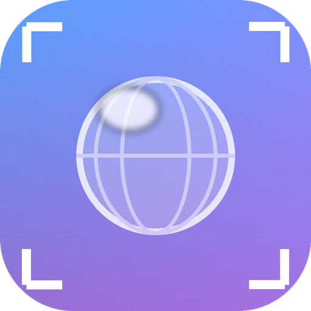
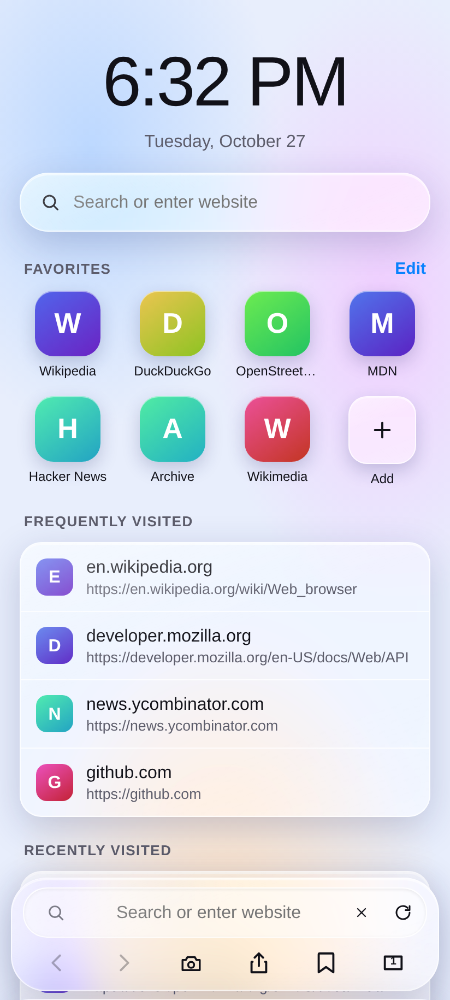
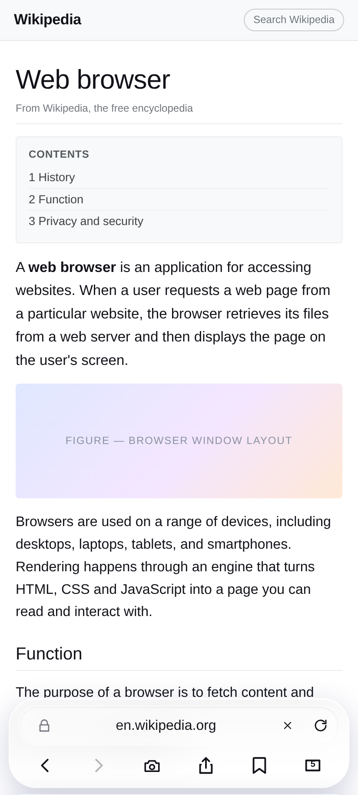
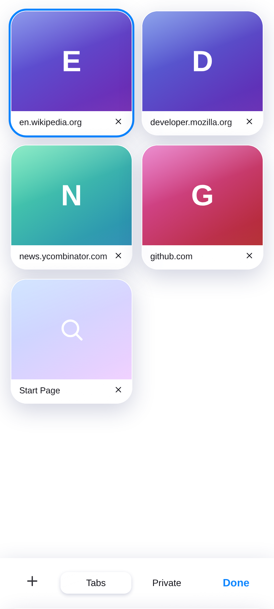
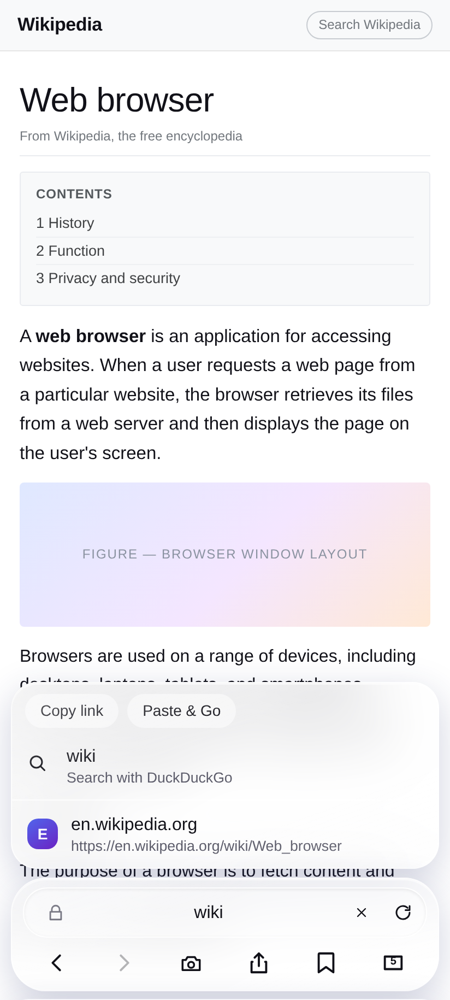
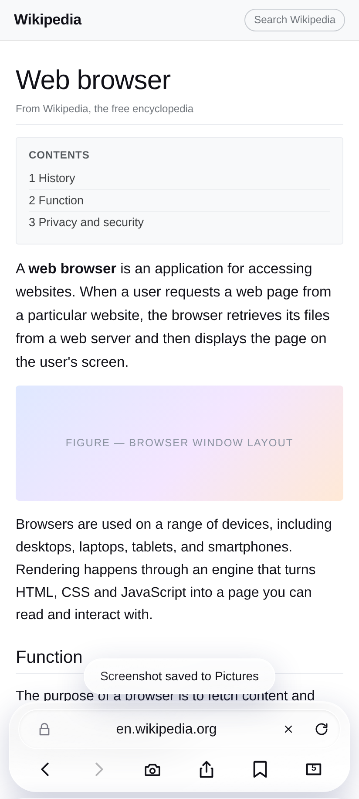
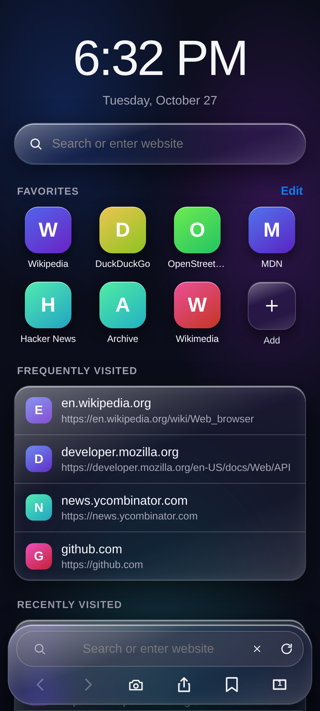

<p align="center"></p>

# Glass Browser

> **Version 1.1** · [**Download the signed APK**](https://github.com/technicalnihilist-lgtm/glass-browser/releases/download/v1.1/GlassBrowser.apk) · [all releases](https://github.com/technicalnihilist-lgtm/glass-browser/releases)
>
> 89 KB · Android 7.0+ · no ads, no account, no analytics

A complete, working Android web browser with a liquid-glass interface.
The chrome is a single HTML/CSS file; the pages are rendered by the system
Android **WebView** (Chromium). Nothing is a mock-up — it loads real sites,
keeps real tabs and history, downloads real files and takes real screenshots.

* **Package name:** `com.rajok.glassbrowser`
* **Application name:** Glass Browser
* **Min SDK:** 24 (Android 7.0) · **Target / compile SDK:** 34 (Android 14)
* **Language / UI:** Java + a single-file HTML/CSS/JS interface
* **Rendering:** `android.webkit.WebView` (Chromium)
* **APK size:** ~90 KB, signed and installable as-is

---

## Why it is a real browser and not a wrapped web page

The obvious way to build a browser out of an HTML file is an `<iframe>`. That
does not work: nearly every large site sends `X-Frame-Options: DENY` or a
`frame-ancestors` CSP, so Google, Wikipedia, YouTube and most banks refuse to
load. The original prototype had exactly this problem.

Glass Browser splits the job in two:

| Layer | What it is | Job |
| --- | --- | --- |
| **Chrome** | a `WebView` loading `assets/index.html`, transparent, pinned to the bottom | address bar, tabs, sheets, settings — all the glass UI |
| **Content** | one `WebView` per tab, full size, behind the chrome | renders the actual page with real Chromium |

The two talk over a `@JavascriptInterface` bridge. The chrome resizes itself on
demand (`setChrome(px)`): a ~120 dp strip while you browse, and full-screen the
moment the start page, tab switcher, a sheet or the address-bar suggestions
appear — so the glass panels float over the live page with the page visible
behind them.

Every tab owns its own content WebView, so switching tabs keeps the page exactly
as you left it — scroll position, half-filled forms, a playing video. Only the
visible one is drawn; the rest sit paused behind it. Live WebViews are capped by
the device's memory class (2–6, from `ActivityManager.getMemoryClass()`) and the
least recently used one is destroyed when the cap is reached. Its URL lives in
the tab list, so returning to it reloads the page rather than losing the tab.

---

## What is implemented

### Browsing
* Real WebView rendering of any site — links, forms, cookies, sessions,
  redirects, HTTP auth, HTML5 video, file uploads.
* Address bar that tells a URL from a search query: `example.com` opens the
  site, `wikipedia` searches. Engine is switchable (DuckDuckGo, Google, Bing,
  Ecosia, Wikipedia).
* Back / forward per tab, with a stack that understands the difference between
  a link you tapped and a server redirect — a `http → https → www` hop replaces
  the entry instead of piling up three of them.
* Pop-ups and `target="_blank"` links open as new tabs (a throwaway WebView
  catches the URL, then the tab is created for real).
* Downloads go through Android's `DownloadManager` with cookies and user agent
  attached, and land in the Downloads folder with a notification.
* File pickers for `<input type="file">` use the system document picker.
* Hardware back closes the open sheet, then the tab switcher, then walks the
  tab's history, then exits.

### Heavy pages
* The renderer dying — what Chromium does when a very large page exhausts memory —
  is caught with `onRenderProcessGone` instead of taking the whole app down with
  it. The dead views are torn down and the current tab reloads.
* Progress callbacks are throttled (one every 5%, not one per percent), and
  `localStorage` writes are debounced, so single-page apps that rewrite their URL
  on every scroll cannot stall the UI.
* Pop-ups use a throwaway WebView to capture the target URL; it is removed and
  destroyed as soon as the URL is known, and after 4 seconds if the popup never
  navigates.

### Screenshots
The camera button in the toolbar captures the **whole window** with
`PixelCopy` — page *and* toolbar, exactly what you see — and writes a PNG to
`Pictures/Glass Browser` through `MediaStore` (or the public Pictures directory
plus a media scan on Android 9 and below). A toast confirms the save.

### Tabs
* Normal and private tabs, with private tabs kept out of history and out of
  `localStorage` persistence.
* Tab switcher with live coloured previews, close buttons, and per-mode lists.
* Each tab keeps its own WebView, so switching back to a tab resumes it instead
  of reloading. The tab list can never empty itself: closing the last tab opens
  a fresh one.
* Tabs, history (400 entries), bookmarks and favourites survive app restarts.

### Start page
Live clock, favourites grid (editable, add and remove), frequently visited and
recently visited lists, and a search field — all rendered from real history.

### Privacy and security
* Invalid TLS certificates are **blocked**, not bypassed.
* `javascript:`, `data:`, `file:` and `blob:` addresses are refused.
* Camera and microphone requests are declined; geolocation is declined.
* Referrer can be suppressed; history and all browsing data can be wiped from
  Settings.
* Private tabs are never written to disk.

### Interface
Light and dark themes (follows the system, or forced), a private-mode purple
tint, safe-area insets for notches and gesture bars, glass panels with real
backdrop blur, and reduced-motion support.

---

## Screenshots

| Start page | Browsing |
| --- | --- |
|  |  |

| Tab switcher | Address bar suggestions |
| --- | --- |
|  |  |

| Screenshot saved | Dark mode |
| --- | --- |
|  |  |

---

## Install

The signed APK is in the repository root: **[`GlassBrowser.apk`](GlassBrowser.apk)**.

1. Copy it to the phone and tap it.
2. Allow installs from your browser / Files app when Android asks.
3. Install, then Open. Play Protect may offer to scan an app from outside the
   Play Store — choose *Install anyway*.

It is signed with a self-signed key, so it cannot be updated from a build signed
with a different key. Uninstall the old copy first if you rebuild it yourself.

---

## Build

No Gradle, no Android Studio project — the build is a shell script that calls
`aapt2`, `javac`, `d8`, `zipalign` and `apksigner` directly, which keeps the APK
at 85 KB.

```bash
export ANDROID_SDK=$HOME/Android/Sdk      # needs build-tools 34 + platform android-34
./build.sh                                # -> GlassBrowser.apk
```

If no keystore exists, `build.sh` generates one at `./glass.keystore` (ignored by
git). Point `KEYSTORE=/path/to/key.jks` at your own key to sign a release build.

### Layout

```
app/
  AndroidManifest.xml
  assets/index.html                       the entire glass UI (HTML + CSS + JS)
  java/com/rajok/glassbrowser/
    MainActivity.java                     WebView host, bridge, screenshot, downloads
  res/                                    theme, icon
build.sh
screenshots/
```

### How the bridge works

`MainActivity.Bridge` exposes `nav`, `blank`, `stop`, `setChrome`, `setPopups`,
`share`, `openExternal`, `screenshot` and `exit`. The other direction is one
callback, `window.BN.on(json)`:

```js
{ t: 'start' }                          // page load began
{ t: 'prog',   p: 0-100 }
{ t: 'done' }
{ t: 'visited', push: true, url: '…' }  // history entry; push=false means a redirect
{ t: 'error',  desc: '…' }
{ t: 'shot',   ok: true, msg: '…' }
{ t: 'back' }                           // hardware back pressed
```

---

## Known limitations

* **Camera, microphone and location are declined.** Granting them needs runtime
  permission plumbing that is not wired up; the app stays honest and refuses.
* **No ad blocking, no extensions, no reader mode, no sync.** It is a small,
  self-contained browser.
* **Back/forward is tracked by the chrome layer, not by Chromium's own history.**
  This is what lets tabs be independent, but it means a single-page app that
  rewrites its URL with `pushState` will replace the history entry rather than
  add one.
* **Tabs beyond the live cap reload when you return to them.** On a low-memory
  device that cap can be as low as two WebViews.
* **Tested in a browser engine and verified structurally, not on a physical
  handset.** The UI logic has an automated test pass (start page, navigation,
  redirect collapsing, back/forward, tab creation, error panel, chrome
  resizing); the APK is verified as signed and well-formed. Field reports from
  real devices are welcome.

---

## License

MIT — see [LICENSE](LICENSE).

---

## ⭐ Like this work? Give it a star

If you like this app and our work, please **star this repository** ⭐ and **[follow technicalnihilist-lgtm on GitHub](https://github.com/technicalnihilist-lgtm)**. If our work isn't for you, that's completely fine — the choice is yours. Thank you for stopping by!

<details>
<summary><b>🌍 Same message in 32 languages (A–Z + Indian languages)</b></summary>

- **A — Arabic** (العربية): ⭐ إذا أعجبك هذا التطبيق وعملنا، فيرجى منح المستودع نجمة ومتابعتنا. وإذا لم يعجبك عملنا، فلا مشكلة على الإطلاق — القرار قرارك. شكرًا لزيارتك!
- **B — Bengali** (বাংলা): ⭐ যদি আপনার এই অ্যাপ এবং আমাদের কাজ ভালো লাগে, তবে অনুগ্রহ করে রিপোজিটরিটিকে একটি স্টার দিন এবং আমাদের ফলো করুন। আমাদের কাজ যদি আপনার পছন্দ না হয়, তাতেও কোনো সমস্যা নেই — সিদ্ধান্ত আপনার। আমাদের পেজে আসার জন্য ধন্যবাদ!
- **C — Chinese** (中文): ⭐ 如果你喜欢这个应用和我们的作品，请给仓库点个星标并关注我们。如果我们的作品不适合你，也完全没关系——选择权在你。感谢你的到访！
- **D — Dutch** (Nederlands): ⭐ Vind je deze app en ons werk leuk? Geef de repository dan een ster en volg ons. Vind je ons werk niets, dan is dat helemaal prima — de keuze is aan jou. Bedankt voor je bezoek!
- **E — English** (English): ⭐ If you like this app and our work, please give the repository a star and follow us. If our work isn't for you, that's completely fine — the choice is yours. Thank you for stopping by!
- **F — French** (Français): ⭐ Si cette application et notre travail vous plaisent, mettez une étoile au dépôt et suivez-nous. Si notre travail n'est pas pour vous, aucun souci — c'est votre choix. Merci de votre visite !
- **G — German** (Deutsch): ⭐ Wenn dir diese App und unsere Arbeit gefallen, gib dem Repository einen Stern und folge uns. Wenn unsere Arbeit nichts für dich ist, ist das völlig in Ordnung — die Wahl liegt bei dir. Danke fürs Vorbeischauen!
- **H — Hindi** (हिन्दी): ⭐ अगर आपको यह ऐप और हमारा काम पसंद है, तो कृपया रिपॉजिटरी को स्टार दें और हमें फॉलो करें। अगर हमारा काम आपके लिए नहीं है, तो भी कोई बात नहीं — यह पूरी तरह आपकी मर्ज़ी है। यहाँ आने के लिए आपका धन्यवाद!
- **I — Indonesian** (Bahasa Indonesia): ⭐ Jika kamu suka aplikasi ini dan karya kami, beri bintang pada repositori ini dan ikuti kami. Kalau karya kami bukan untukmu, tidak masalah sama sekali — itu pilihanmu. Terima kasih sudah mampir!
- **J — Japanese** (日本語): ⭐ このアプリと私たちの仕事が気に入ったら、リポジトリにスターを付けてフォローしてください。合わない場合はまったく問題ありません — 選ぶのはあなたです。お越しいただきありがとうございます！
- **K — Korean** (한국어): ⭐ 이 앱과 저희 작업이 마음에 드신다면 저장소에 스타를 눌러 주시고 팔로우해 주세요. 저희 작업이 맞지 않으셔도 전혀 괜찮습니다 — 선택은 여러분의 몫입니다. 방문해 주셔서 감사합니다!
- **L — Lithuanian** (Lietuvių): ⭐ Jei tau patinka ši programa ir mūsų darbas, duok saugyklai žvaigždutę ir sek mus. Jei mūsų darbas ne tau, viskas gerai — pasirinkimas tavo. Ačiū, kad užsukai!
- **M — Malayalam** (മലയാളം): ⭐ നിങ്ങൾക്ക് ഈ ആപ്പും ഞങ്ങളുടെ പ്രവർത്തനവും ഇഷ്ടപ്പെട്ടെങ്കിൽ, ദയവായി റെപ്പോസിറ്ററിക്ക് ഒരു സ്റ്റാർ നൽകുകയും ഞങ്ങളെ ഫോളോ ചെയ്യുകയും ചെയ്യുക. ഞങ്ങളുടെ പ്രവർത്തനം നിങ്ങൾക്ക് അനുയോജ്യമല്ലെങ്കിൽ, അതും തികച്ചും കുഴപ്പമില്ല — തീരുമാനം നിങ്ങളുടേതാണ്. ഇവിടെ വന്നതിന് നന്ദി!
- **N — Nepali** (नेपाली): ⭐ यदि तपाईंलाई यो एप र हाम्रो काम मन पर्‍यो भने, कृपया रिपोजिटरीलाई स्टार दिनुहोस् र हामीलाई फलो गर्नुहोस्। यदि हाम्रो काम तपाईंलाई मन पर्दैन भने, पनि ठीकै छ — यो तपाईंको इच्छा हो। यहाँ आउनुभएकोमा धन्यवाद!
- **O — Odia** (ଓଡ଼ିଆ): ⭐ ଯଦି ଆପଣଙ୍କୁ ଏହି ଆପ୍ ଏବଂ ଆମର କାମ ଭଲ ଲାଗୁଛି, ତେବେ ଦୟାକରି ରିପୋଜିଟୋରୀକୁ ଗୋଟିଏ ଷ୍ଟାର୍ ଦିଅନ୍ତୁ ଏବଂ ଆମକୁ ଫଲୋ କରନ୍ତୁ। ଯଦି ଆମର କାମ ଆପଣଙ୍କ ପାଇଁ ନୁହେଁ, ତେବେ କିଛି ଅସୁବିଧା ନାହିଁ — ପସନ୍ଦ ଆପଣଙ୍କର। ଆମ ପାଖକୁ ଆସିଥିବାରୁ ଧନ୍ୟବାଦ!
- **P — Polish** (Polski): ⭐ Jeśli podoba Ci się ta aplikacja i nasza praca, daj repozytorium gwiazdkę i obserwuj nas. Jeśli nasza praca nie jest dla Ciebie, to zupełnie w porządku — wybór należy do Ciebie. Dziękujemy za odwiedziny!
- **Q — Quechua** (Runa Simi): ⭐ Kay app, ñuqaykup ruwasqanchikpas gustasunki chayqa, repositorioman huk estrella churay, ñuqaykutapas qatipayku. Mana gustasunki chayqa, allinmi — qampa akllayki. Hamusqaykimanta sulpayki!
- **R — Russian** (Русский): ⭐ Если вам нравится это приложение и наша работа, поставьте звёздочку репозиторию и подпишитесь на нас. Если наша работа не для вас — это совершенно нормально, выбор за вами. Спасибо, что заглянули!
- **S — Spanish** (Español): ⭐ Si te gusta esta app y nuestro trabajo, dale una estrella al repositorio y síguenos. Si nuestro trabajo no es para ti, no pasa nada — la decisión es tuya. ¡Gracias por pasarte!
- **T — Tamil** (தமிழ்): ⭐ உங்களுக்கு இந்த ஆப்பும் எங்க வேலையும் பிடிச்சிருந்தா, தயவுசெஞ்சு இந்த ரெபாசிட்டரிக்கு ஒரு ஸ்டார் குடுத்து, எங்களை ஃபாலோ பண்ணுங்க. எங்க வேலை உங்களுக்கு செட் ஆகலைன்னாலும் பரவாயில்லை — அது உங்க விருப்பம். இங்கே வந்ததுக்கு நன்றி!
- **U — Urdu** (اردو): ⭐ اگر آپ کو یہ ایپ اور ہمارا کام پسند آئے تو براہ کرم ریپازٹری کو سٹار دیں اور ہمیں فالو کریں۔ اگر ہمارا کام آپ کے لیے نہیں ہے، تو یہ بالکل ٹھیک ہے — انتخاب آپ کا ہے۔ یہاں تشریف لانے کا شکریہ!
- **V — Vietnamese** (Tiếng Việt): ⭐ Nếu bạn thích ứng dụng này và công việc của chúng tôi, hãy tặng kho lưu trữ một ngôi sao và theo dõi chúng tôi. Nếu công việc của chúng tôi không phù hợp với bạn, điều đó hoàn toàn ổn — lựa chọn là của bạn. Cảm ơn bạn đã ghé qua!
- **W — Welsh** (Cymraeg): ⭐ Os ydych chi'n hoffi'r ap hwn a'n gwaith, rhowch seren i'r storfa a dilynwch ni. Os nad yw ein gwaith ar eich cyfer, mae hynny'n hollol iawn — chi sydd i benderfynu. Diolch am alw heibio!
- **X — Xhosa** (isiXhosa): ⭐ Ukuba uyayithanda le app nomsebenzi wethu, nika irepo inkwenkwezi kwaye usilandele. Ukuba umsebenzi wethu awukufanelanga, akukho ngxaki — lukhetho lwakho. Enkosi ngokutyelela!
- **Y — Yoruba** (Yorùbá): ⭐ Bí app yìí àti iṣẹ́ wa bá wù ọ́, jọ̀wọ́ fún àkójọpọ̀ náà ní ìràwọ̀ kí o sì tẹ̀lé wa. Bí iṣẹ́ wa kò bá yẹ ọ́, kò séwu — ìwọ ni ó yàn. Ẹ ṣé fún wíwá!
- **Z — Zulu** (isiZulu): ⭐ Uma uthanda le app nomsebenzi wethu, nikeza isitoreji inkanyezi bese usilandela. Uma umsebenzi wethu ungakufanele, akunankinga — wukukhetha kwakho. Siyabonga ngokuvakasha!

**More Indian languages**

- **Assamese** (অসমীয়া): ⭐ যদি আপুনি এই এপটো আৰু আমাৰ কাম ভাল পায়, তেন্তে অনুগ্ৰহ কৰি ৰিপজিটৰীটোক এটা ষ্টাৰ দিয়ক আৰু আমাক ফ'ল' কৰক। যদি আমাৰ কাম আপোনাৰ বাবে নহয়, তেন্তে সেয়া একেবাৰে ঠিক আছে — সিদ্ধান্তটো আপোনাৰ। আমাৰ ইয়ালৈ অহাৰ বাবে ধন্যবাদ!
- **Gujarati** (ગુજરાતી): ⭐ જો તમને આ એપ અને અમારું કામ ગમતું હોય, તો પ્લીઝ રિપોઝિટરીને સ્ટાર આપો અને અમને ફોલો કરો. જો અમારું કામ તમને ન ગમતું હોય, તો તે પણ બરાબર છે — પસંદગી તમારી છે. અહીં આવવા બદલ આભાર!
- **Kannada** (ಕನ್ನಡ): ⭐ ನಿಮಗೆ ಈ ಆ್ಯಪ್ ಮತ್ತು ನಮ್ಮ ಕೆಲಸ ಇಷ್ಟವಾದರೆ, ದಯವಿಟ್ಟು ರೆಪೊಸಿಟರಿಗೆ ಸ್ಟಾರ್ ಕೊಡಿ ಮತ್ತು ನಮ್ಮನ್ನು ಫಾಲೋ ಮಾಡಿ. ನಮ್ಮ ಕೆಲಸ ನಿಮಗೆ ಸರಿಹೊಂದದಿದ್ದರೆ, ಅದೂ ಪರವಾಗಿಲ್ಲ — ಆಯ್ಕೆ ನಿಮ್ಮದು. ಭೇಟಿ ನೀಡಿದ್ದಕ್ಕೆ ಧನ್ಯವಾದಗಳು!
- **Marathi** (मराठी): ⭐ जर तुम्हाला हे ॲप आणि आमचं काम आवडलं असेल, तर कृपया रिपॉझिटरीला स्टार द्या आणि आम्हाला फॉलो करा. जर आमचं काम तुम्हाला आवडत नसेल, तर काही हरकत नाही — ती तुमची निवड आहे. इथे आल्याबद्दल धन्यवाद!
- **Punjabi** (ਪੰਜਾਬੀ): ⭐ ਜੇ ਤੁਹਾਨੂੰ ਇਹ ਐਪ ਅਤੇ ਸਾਡਾ ਕੰਮ ਪਸੰਦ ਹੈ, ਤਾਂ ਕਿਰਪਾ ਕਰਕੇ ਰਿਪੋਜ਼ਟਰੀ ਨੂੰ ਸਟਾਰ ਦਿਓ ਅਤੇ ਸਾਨੂੰ ਫਾਲੋ ਕਰੋ। ਜੇ ਸਾਡਾ ਕੰਮ ਤੁਹਾਡੇ ਲਈ ਨਹੀਂ ਹੈ, ਤਾਂ ਕੋਈ ਗੱਲ ਨਹੀਂ — ਚੋਣ ਤੁਹਾਡੀ ਹੈ। ਸਾਡੇ ਪੇਜ 'ਤੇ ਆਉਣ ਲਈ ਧੰਨਵਾਦ!
- **Telugu** (తెలుగు): ⭐ మీకు ఈ యాప్, మా పని నచ్చితే, దయచేసి రిపోజిటరీకి ఒక స్టార్ ఇచ్చి మమ్మల్ని ఫాలో అవ్వండి. ఒకవేళ మా పని మీకు నచ్చకపోతే, పర్వాలేదు — అది మీ ఇష్టం. మమ్మల్ని సందర్శించినందుకు ధన్యవాదాలు!

</details>
