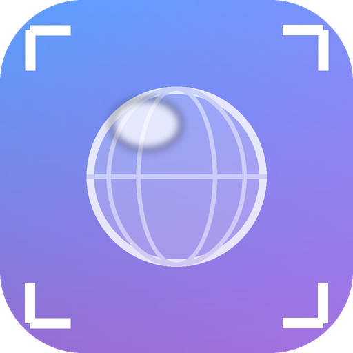
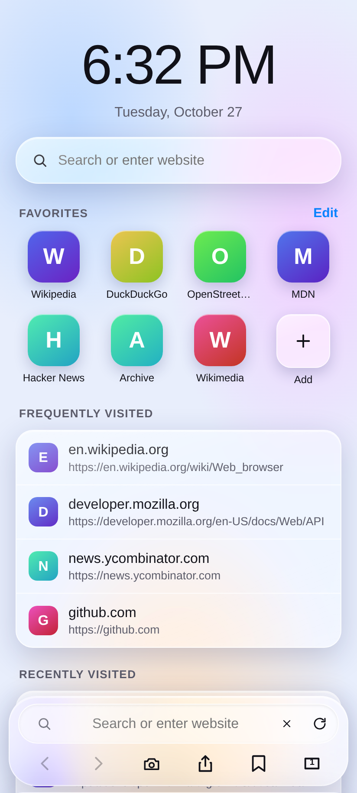
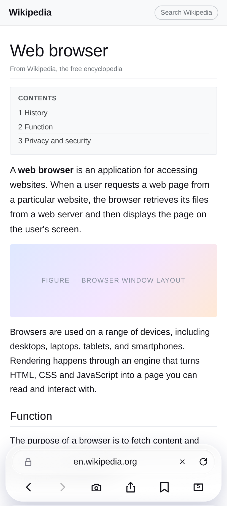
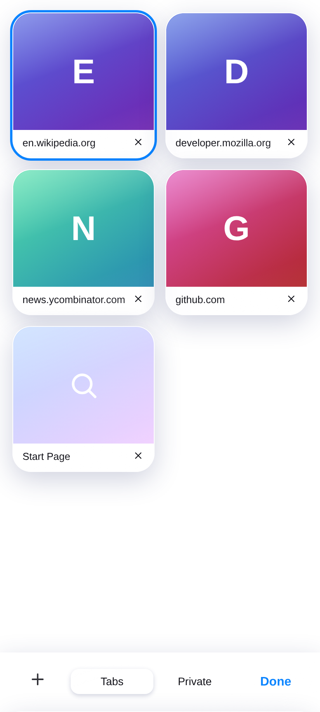
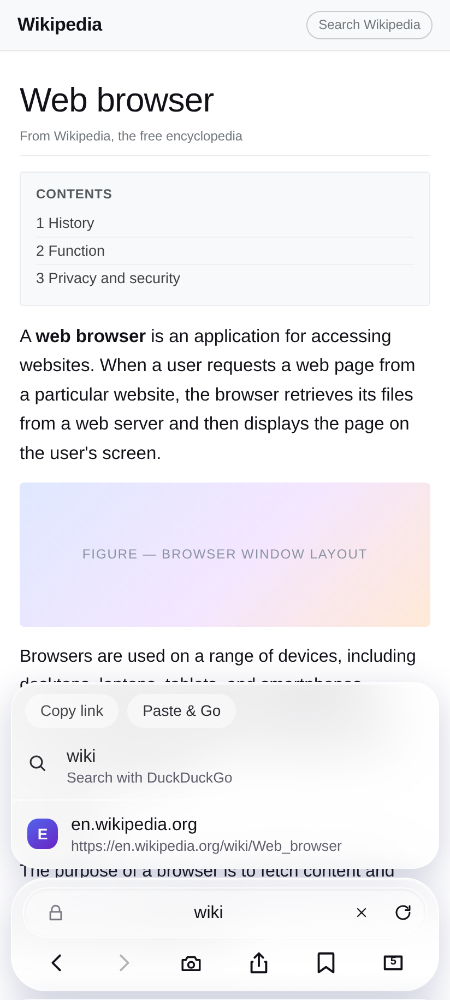
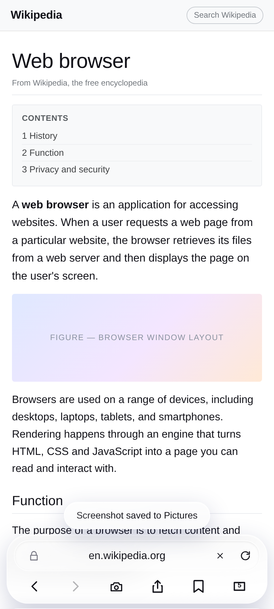
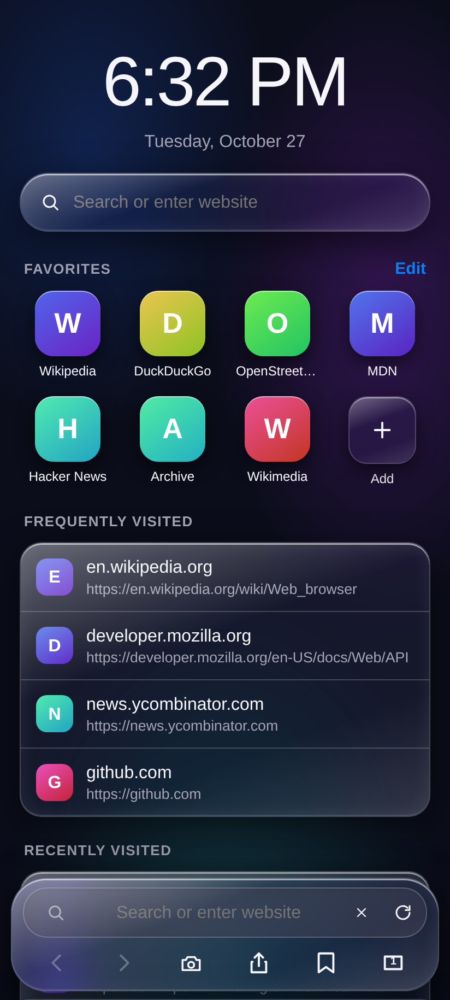

<div align="center">

<a href="https://github.com/technicalnihilist-lgtm/glass-browser/stargazers"></a>&nbsp;<a href="https://github.com/technicalnihilist-lgtm/glass-browser/network/members"></a>

<h3>A complete, working Android web browser with a liquid-glass interface — single-file HTML chrome…</h3>

   

<a href="https://github.com/technicalnihilist-lgtm/glass-browser/releases/latest"></a>

<b>Support the work</b>

  

<sub>Donations aren't live yet — Paytm, UPI, PayPal and Buy&nbsp;Me&nbsp;a&nbsp;Coffee all show <b>coming soon</b>. Until then, a ⭐ star is the best support.</sub>

<a href="https://github.com/technicalnihilist-lgtm/glass-browser/releases/latest"></a>  <a href="https://github.com/technicalnihilist-lgtm/glass-browser/releases"></a>

<h4>Get it from</h4>

<a href="https://github.com/technicalnihilist-lgtm/glass-browser/releases"></a> <a href="https://github.com/technicalnihilist-lgtm/glass-browser/archive/refs/heads/main.zip"></a>

</div>

---

---

<p align="center"></p>

## Why it is a real browser and not a wrapped web page

The obvious way to build a browser out of an HTML file is an `<iframe>`. That
does not work: nearly every large site sends `X-Frame-Options: DENY` or a
`frame-ancestors` CSP, so Google, Wikipedia, YouTube and most banks refuse to
load. The original prototype had exactly this problem.

Glass Browser splits the job in two:

| Layer | What it is | Job |
| --- | --- | --- |
| **Chrome** | a `WebView` loading `assets/index.html`, transparent, pinned to the bottom | address bar, tabs, sheets, settings — all the glass UI |
| **Content** | one `WebView` per tab, full size, behind the chrome | renders the actual page with real Chromium |

The two talk over a `@JavascriptInterface` bridge. The chrome resizes itself on
demand (`setChrome(px)`): a ~120 dp strip while you browse, and full-screen the
moment the start page, tab switcher, a sheet or the address-bar suggestions
appear — so the glass panels float over the live page with the page visible
behind them.

Every tab owns its own content WebView, so switching tabs keeps the page exactly
as you left it — scroll position, half-filled forms, a playing video. Only the
visible one is drawn; the rest sit paused behind it. Live WebViews are capped by
the device's memory class (2–6, from `ActivityManager.getMemoryClass()`) and the
least recently used one is destroyed when the cap is reached. Its URL lives in
the tab list, so returning to it reloads the page rather than losing the tab.

---

## What is implemented

### Browsing
* Real WebView rendering of any site — links, forms, cookies, sessions,
  redirects, HTTP auth, HTML5 video, file uploads.
* Address bar that tells a URL from a search query: `example.com` opens the
  site, `wikipedia` searches. Engine is switchable (DuckDuckGo, Google, Bing,
  Ecosia, Wikipedia).
* Back / forward per tab, with a stack that understands the difference between
  a link you tapped and a server redirect — a `http → https → www` hop replaces
  the entry instead of piling up three of them.
* Pop-ups and `target="_blank"` links open as new tabs (a throwaway WebView
  catches the URL, then the tab is created for real).
* Downloads go through Android's `DownloadManager` with cookies and user agent
  attached, and land in the Downloads folder with a notification.
* File pickers for `<input type="file">` use the system document picker.
* Hardware back closes the open sheet, then the tab switcher, then walks the
  tab's history, then exits.

### Heavy pages
* The renderer dying — what Chromium does when a very large page exhausts memory —
  is caught with `onRenderProcessGone` instead of taking the whole app down with
  it. The dead views are torn down and the current tab reloads.
* Progress callbacks are throttled (one every 5%, not one per percent), and
  `localStorage` writes are debounced, so single-page apps that rewrite their URL
  on every scroll cannot stall the UI.
* Pop-ups use a throwaway WebView to capture the target URL; it is removed and
  destroyed as soon as the URL is known, and after 4 seconds if the popup never
  navigates.

### Screenshots
The camera button in the toolbar captures the **whole window** with
`PixelCopy` — page *and* toolbar, exactly what you see — and writes a PNG to
`Pictures/Glass Browser` through `MediaStore` (or the public Pictures directory
plus a media scan on Android 9 and below). A toast confirms the save.

### Tabs
* Normal and private tabs, with private tabs kept out of history and out of
  `localStorage` persistence.
* Tab switcher with live coloured previews, close buttons, and per-mode lists.
* Each tab keeps its own WebView, so switching back to a tab resumes it instead
  of reloading. The tab list can never empty itself: closing the last tab opens
  a fresh one.
* Tabs, history (400 entries), bookmarks and favourites survive app restarts.

### Start page
Live clock, favourites grid (editable, add and remove), frequently visited and
recently visited lists, and a search field — all rendered from real history.

### Privacy and security
* Invalid TLS certificates are **blocked**, not bypassed.
* `javascript:`, `data:`, `file:` and `blob:` addresses are refused.
* Camera and microphone requests are declined; geolocation is declined.
* Referrer can be suppressed; history and all browsing data can be wiped from
  Settings.
* Private tabs are never written to disk.

### Interface
Light and dark themes (follows the system, or forced), a private-mode purple
tint, safe-area insets for notches and gesture bars, glass panels with real
backdrop blur, and reduced-motion support.

---

## Screenshots

| Start page | Browsing |
| --- | --- |
|  |  |

| Tab switcher | Address bar suggestions |
| --- | --- |
|  |  |

| Screenshot saved | Dark mode |
| --- | --- |
|  |  |

---

## Install

The signed APK is in the repository root: **[`GlassBrowser.apk`](GlassBrowser.apk)**.

1. Copy it to the phone and tap it.
2. Allow installs from your browser / Files app when Android asks.
3. Install, then Open. Play Protect may offer to scan an app from outside the
   Play Store — choose *Install anyway*.

It is signed with a self-signed key, so it cannot be updated from a build signed
with a different key. Uninstall the old copy first if you rebuild it yourself.

---

## Build

No Gradle, no Android Studio project — the build is a shell script that calls
`aapt2`, `javac`, `d8`, `zipalign` and `apksigner` directly, which keeps the APK
at 85 KB.

```bash
export ANDROID_SDK=$HOME/Android/Sdk      # needs build-tools 34 + platform android-34
./build.sh                                # -> GlassBrowser.apk
```

If no keystore exists, `build.sh` generates one at `./glass.keystore` (ignored by
git). Point `KEYSTORE=/path/to/key.jks` at your own key to sign a release build.

### Layout

```
app/
  AndroidManifest.xml
  assets/index.html                       the entire glass UI (HTML + CSS + JS)
  java/com/rajok/glassbrowser/
    MainActivity.java                     WebView host, bridge, screenshot, downloads
  res/                                    theme, icon
build.sh
screenshots/
```

### How the bridge works

`MainActivity.Bridge` exposes `nav`, `blank`, `stop`, `setChrome`, `setPopups`,
`share`, `openExternal`, `screenshot` and `exit`. The other direction is one
callback, `window.BN.on(json)`:

```js
{ t: 'start' }                          // page load began
{ t: 'prog',   p: 0-100 }
{ t: 'done' }
{ t: 'visited', push: true, url: '…' }  // history entry; push=false means a redirect
{ t: 'error',  desc: '…' }
{ t: 'shot',   ok: true, msg: '…' }
{ t: 'back' }                           // hardware back pressed
```

---

## Known limitations

* **Camera, microphone and location are declined.** Granting them needs runtime
  permission plumbing that is not wired up; the app stays honest and refuses.
* **No ad blocking, no extensions, no reader mode, no sync.** It is a small,
  self-contained browser.
* **Back/forward is tracked by the chrome layer, not by Chromium's own history.**
  This is what lets tabs be independent, but it means a single-page app that
  rewrites its URL with `pushState` will replace the history entry rather than
  add one.
* **Tabs beyond the live cap reload when you return to them.** On a low-memory
  device that cap can be as low as two WebViews.
* **Tested in a browser engine and verified structurally, not on a physical
  handset.** The UI logic has an automated test pass (start page, navigation,
  redirect collapsing, back/forward, tab creation, error panel, chrome
  resizing); the APK is verified as signed and well-formed. Field reports from
  real devices are welcome.

---

## License

MIT — see [LICENSE](LICENSE).

---

---

## 🌍 Languages

<sub>Donations are <b>coming soon</b> in every language below — nothing to pay today, nothing to click.</sub>

<div align="center">

<sub><b>हिन्दी · বাংলা · मराठी · తెలుగు · தமிழ் · ગુજરાતી · ಕನ್ನಡ · മലയാളം · ਪੰਜਾਬੀ · ଓଡ଼ିଆ · অসমীয়া · اردو</b></sub>

</div>

<details>
<summary><b>🌍 Open the same message in 53 languages</b></summary>

**🇮🇳 Indian languages**

- **हिन्दी** (Hindi) — ☕ जल्द ही आ रहा है। · ⭐ अगर आपको यह ऐप और हमारा काम पसंद है, तो कृपया रिपॉजिटरी को स्टार दें और हमें फॉलो करें।
- **বাংলা** (Bengali) — ☕ খুব শিগগিরই আসছে। · ⭐ যদি আপনার এই অ্যাপ এবং আমাদের কাজ ভালো লাগে, তবে অনুগ্রহ করে রিপোজিটরিটিকে একটি স্টার দিন এবং আমাদের ফলো করুন।
- **मराठी** (Marathi) — ☕ लवकरच येत आहे. · ⭐ जर तुम्हाला हे ॲप आणि आमचं काम आवडलं असेल, तर कृपया रिपॉझिटरीला स्टार द्या आणि आम्हाला फॉलो करा.
- **తెలుగు** (Telugu) — ☕ త్వరలో రాబోతోంది. · ⭐ మీకు ఈ యాప్, మా పని నచ్చితే, దయచేసి రిపోజిటరీకి ఒక స్టార్ ఇచ్చి మమ్మల్ని ఫాలో అవ్వండి.
- **தமிழ்** (Tamil) — ☕ விரைவில் வருகிறது. · ⭐ உங்களுக்கு இந்த ஆப்பும் எங்க வேலையும் பிடிச்சிருந்தா, தயவுசெஞ்சு இந்த ரெபாசிட்டரிக்கு ஒரு ஸ்டார்…
- **ગુજરાતી** (Gujarati) — ☕ ટૂંક સમયમાં આવી રહ્યું છે. · ⭐ જો તમને આ એપ અને અમારું કામ ગમતું હોય, તો પ્લીઝ રિપોઝિટરીને સ્ટાર આપો અને અમને ફોલો કરો.
- **ಕನ್ನಡ** (Kannada) — ☕ ಶೀಘ್ರದಲ್ಲೇ ಬರುತ್ತಿದೆ. · ⭐ ನಿಮಗೆ ಈ ಆ್ಯಪ್ ಮತ್ತು ನಮ್ಮ ಕೆಲಸ ಇಷ್ಟವಾದರೆ, ದಯವಿಟ್ಟು ರೆಪೊಸಿಟರಿಗೆ ಸ್ಟಾರ್ ಕೊಡಿ ಮತ್ತು ನಮ್ಮನ್ನು ಫಾಲೋ ಮಾಡಿ.
- **മലയാളം** (Malayalam) — ☕ ഉടൻ വരുന്നു. · ⭐ നിങ്ങൾക്ക് ഈ ആപ്പും ഞങ്ങളുടെ പ്രവർത്തനവും ഇഷ്ടപ്പെട്ടെങ്കിൽ, ദയവായി റെപ്പോസിറ്ററിക്ക് ഒരു സ്റ്റാർ…
- **ਪੰਜਾਬੀ** (Punjabi) — ☕ ਜਲਦੀ ਆ ਰਿਹਾ ਹੈ। · ⭐ ਜੇ ਤੁਹਾਨੂੰ ਇਹ ਐਪ ਅਤੇ ਸਾਡਾ ਕੰਮ ਪਸੰਦ ਹੈ, ਤਾਂ ਕਿਰਪਾ ਕਰਕੇ ਰਿਪੋਜ਼ਟਰੀ ਨੂੰ ਸਟਾਰ ਦਿਓ ਅਤੇ ਸਾਨੂੰ ਫਾਲੋ ਕਰੋ।
- **ଓଡ଼ିଆ** (Odia) — ☕ ଖୁବ୍ ଶୀଘ୍ର ଆସୁଛି। · ⭐ ଯଦି ଆପଣଙ୍କୁ ଏହି ଆପ୍ ଏବଂ ଆମର କାମ ଭଲ ଲାଗୁଛି, ତେବେ ଦୟାକରି ରିପୋଜିଟୋରୀକୁ ଗୋଟିଏ ଷ୍ଟାର୍ ଦିଅନ୍ତୁ ଏବଂ ଆମକୁ ଫଲୋ କରନ୍ତୁ।
- **অসমীয়া** (Assamese) — ☕ অতি সোনকালেই আহি আছে। · ⭐ যদি আপুনি এই এপটো আৰু আমাৰ কাম ভাল পায়, তেন্তে অনুগ্ৰহ কৰি ৰিপজিটৰীটোক এটা ষ্টাৰ দিয়ক আৰু আমাক ফ'ল' কৰক।
- **اردو** (Urdu) — ☕ جلد آرہا ہے۔ · ⭐ اگر آپ کو یہ ایپ اور ہمارا کام پسند آئے تو براہ کرم ریپازٹری کو سٹار دیں اور ہمیں فالو کریں۔
- **संस्कृतम्** (Sanskrit) — ☕ शीघ्रमेव आगच्छति।
- **मैथिली** (Maithili) — ☕ जल्दिये आबि रहल अछि।
- **कोंकणी** (Konkani) — ☕ रोखडेंच येता.
- **کٲشُر** (Kashmiri) — ☕ جَلدی یِوان چھُ۔
- **سنڌي** (Sindhi) — ☕ जल्द अची रह्यो आहे।
- **डोगरी** (Dogri) — ☕ जल्दी आ करदा ऐ।
- **ꯃꯤꯇꯩ ꯂꯣꯟ** (Manipuri) — ☕ ꯑꯊꯨꯕꯥ ꯃꯇꯝꯗꯥ ꯂꯥꯛꯀꯅꯤ꯫
- **बर’** (Bodo) — ☕ थाबैनो फैगोन।
- **ᱥᱟᱱᱛᱟᱲᱤ** (Santali) — ☕ ᱞᱚᱜᱚᱱ ᱦᱤᱡᱩᱜ ᱠᱟᱱᱟ᱾
- **नेपाली** (Nepali) — ☕ छिट्टै आउँदैछ। · ⭐ यदि तपाईंलाई यो एप र हाम्रो काम मन पर्‍यो भने, कृपया रिपोजिटरीलाई स्टार दिनुहोस् र हामीलाई फलो गर्नुहोस्।

**🌍 World languages**

- **العربية** (Arabic) — ☕ قريبًا. · ⭐ إذا أعجبك هذا التطبيق وعملنا، فيرجى منح المستودع نجمة ومتابعتنا.
- **简体中文** (Chinese (Simplified)) — ☕ 即将推出。
- **繁體中文** (Chinese (Traditional)) — ☕ 即將推出。
- **Čeština** (Czech) — ☕ Již brzy.
- **Dansk** (Danish) — ☕ Kommer snart.
- **Nederlands** (Dutch) — ☕ Binnenkort beschikbaar. · ⭐ Vind je deze app en ons werk leuk?
- **Filipino** (Filipino) — ☕ Malapit na.
- **Suomi** (Finnish) — ☕ Tulossa pian.
- **Français** (French) — ☕ Bientôt disponible. · ⭐ Si cette application et notre travail vous plaisent, mettez une étoile au dépôt et suivez-nous.
- **Deutsch** (German) — ☕ Bald verfügbar. · ⭐ Wenn dir diese App und unsere Arbeit gefallen, gib dem Repository einen Stern und folge uns.
- **Ελληνικά** (Greek) — ☕ Έρχεται σύντομα.
- **עברית** (Hebrew) — ☕ בקרוב.
- **Magyar** (Hungarian) — ☕ Hamarosan.
- **Bahasa Indonesia** (Indonesian) — ☕ Segera hadir. · ⭐ Jika kamu suka aplikasi ini dan karya kami, beri bintang pada repositori ini dan ikuti kami.
- **Italiano** (Italian) — ☕ In arrivo.
- **日本語** (Japanese) — ☕ 近日公開。 · ⭐ このアプリと私たちの仕事が気に入ったら、リポジトリにスターを付けてフォローしてください。
- **한국어** (Korean) — ☕ 곧 공개됩니다. · ⭐ 이 앱과 저희 작업이 마음에 드신다면 저장소에 스타를 눌러 주시고 팔로우해 주세요.
- **Bahasa Melayu** (Malay) — ☕ Akan datang.
- **Norsk** (Norwegian) — ☕ Kommer snart.
- **فارسی** (Persian) — ☕ به‌زودی.
- **Polski** (Polish) — ☕ Wkrótce. · ⭐ Jeśli podoba Ci się ta aplikacja i nasza praca, daj repozytorium gwiazdkę i obserwuj nas.
- **Português** (Portuguese) — ☕ Em breve.
- **Română** (Romanian) — ☕ În curând.
- **Русский** (Russian) — ☕ Скоро. · ⭐ Если вам нравится это приложение и наша работа, поставьте звёздочку репозиторию и подпишитесь на нас.
- **Español** (Spanish) — ☕ Muy pronto. · ⭐ Si te gusta esta app y nuestro trabajo, dale una estrella al repositorio y síguenos.
- **Kiswahili** (Swahili) — ☕ Inakuja hivi karibuni.
- **Svenska** (Swedish) — ☕ Kommer snart.
- **ไทย** (Thai) — ☕ เร็ว ๆ นี้
- **Türkçe** (Turkish) — ☕ Çok yakında.
- **Українська** (Ukrainian) — ☕ Незабаром.
- **Tiếng Việt** (Vietnamese) — ☕ Sắp ra mắt. · ⭐ Nếu bạn thích ứng dụng này và công việc của chúng tôi, hãy tặng kho lưu trữ một ngôi sao và theo…

</details>

